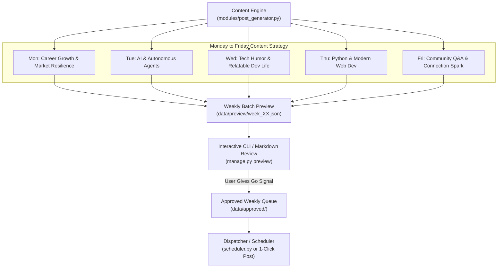

# LinkedIn Content Automation & Account Management System Plan (v2)

## Goal Description
Build an automated, intelligent LinkedIn management system tailored specifically to your background, voice, and target community. The system generates a curated **Monday-to-Friday weekly batch of 5 posts** mapped to distinct content pillars (Career Growth in a tough market, AI & Agents, Tech Humor, Python/Web Dev, and Community Engagement).

It introduces a **Weekly Preview & "Go Signal" Approval Workflow**: you inspect the complete 5-day schedule, tweak or regenerate any day if desired, and provide your approval ("go signal") before anything enters the publishing queue.



---

## User Review Required

> [!IMPORTANT]
> **Weekly Content Calendar Alignment**:
> Here is the proposed theme schedule for your Monday–Friday posts. Please review if this rotation matches your vision:
> - **Monday**: **Career Resilience & Junior Dev Realities** — Navigating the tough job market, portfolio building, overcoming rejection, practical tips for younger computer professionals.
> - **Tuesday**: **AI & Autonomous Agents** — Practical takeaways, tools, breaking down agent architectures simply without hype.
> - **Wednesday**: **Tech Humor & Relatable Dev Memes** — Lighthearted dev struggles (CSS battles, git merge conflicts, production on Fridays) with a relatable educational lesson.
> - **Thursday**: **Python & Web Development Tips** — Bite-sized snippets, FastAPI/React tips, architecture patterns, and clean code principles.
> - **Friday**: **Community Conversation & Networking Spark** — Open questions to invite comments, weekend coding ideas, connecting with fellow devs.

> [!TIP]
> **Weekly "Go Signal" Experience**:
> Every Sunday or Monday morning, the engine drafts all 5 posts. You run `python manage.py preview` to see all 5 formatted posts side-by-side or day-by-day. You can approve all with one keypress (`go`), edit a specific day (`edit 3`), or regenerate a day (`reroll 2`).

---

## Open Questions

None remaining for system design. All previous questions have been incorporated into the configuration and schedule.

---

## Proposed Changes

### 1. Configuration & Persona Definition

#### [NEW] `config/persona.yaml`
Encapsulates your exact persona, audience, tone, and weekly theme structure:
```yaml
profile:
  name: "Mark Wilson"
  target_audience: "Younger Developers, Tech Leads, Recruiters, AI/Python Enthusiasts"
  tone: "Casual, conversational, empathetic, yet deeply educational and authentic"
  core_mission: "Empowering early-career tech professionals and sharing hands-on AI & Web Dev insights"
  rules:
    - "Sound like a genuine human peer, never like a corporate marketer or generic bot"
    - "First 2 lines must be an authentic hook (scroll-stopper)"
    - "Use short, punchy paragraphs with white space for mobile reading"
    - "End with an open, genuine question to spark comments and connection invites"
    - "Include 3-4 organic hashtags (no spam)"

schedule:
  days:
    monday:
      theme: "Career Growth & Market Resilience"
      archetype: "story_and_mindset"
      focus: "Navigating tech job market challenges, portfolios, interview lessons, grit"
    tuesday:
      theme: "AI & Autonomous Agents"
      archetype: "practical_insight"
      focus: "Hands-on agent workflows, LLM tools, real use cases vs buzzwords"
    wednesday:
      theme: "Tech Humor & Dev Life"
      archetype: "humor_with_lesson"
      focus: "Relatable coding struggles, meme-worthy realities, junior vs senior moments"
    thursday:
      theme: "Python & Modern Web Development"
      archetype: "actionable_tip"
      focus: "Python tricks, API patterns, modern frontend/backend tips, clean code"
    friday:
      theme: "Community & Connection Builder"
      archetype: "discussion_spark"
      focus: "Reflections, questions to the network, peer connection invites"
```

#### [NEW] `requirements.txt`
```text
requests>=2.31.0
pyyaml>=6.0.1
rich>=13.7.0
python-dotenv>=1.0.1
feedparser>=6.0.10
```

---

### 2. Ingestion & Post Generation Engine

#### [NEW] `modules/post_generator.py`
Generates high-converting posts structured for the exact daily themes:
- Dynamically loads prompt templates matching the day's archetype.
- Applies character constraints (1,000–1,800 characters, ideal for LinkedIn reading time).
- Guarantees comment-stimulating questions at the bottom of each post.

```python
# Conceptual design for modules/post_generator.py
class PostGenerator:
    def generate_day(self, day_name: str, topic_override: str = None) -> dict:
        """Generates a structured post for a given day according to persona.yaml."""
        ...
    def generate_weekly_batch(self) -> dict[str, dict]:
        """Generates a complete Monday-to-Friday schedule batch."""
        ...
```

#### [NEW] `modules/trend_fetcher.py`
Gathers fresh tech news, popular developer discussions (Hacker News, Dev.to, GitHub trending) to ground the daily posts in real, current discussions.

---

### 3. Weekly Preview & "Go Signal" Review Pipeline

#### [NEW] `modules/queue_manager.py`
Maintains the lifecycle of the weekly batches:
- `data/preview/` — Current week's draft waiting for user go-signal.
- `data/approved/` — Approved posts ready for publishing.
- `data/archive/` — Historical published posts to avoid repetitive content.

#### [NEW] `manage.py`
The master CLI tool for your weekly workflow:
- `python manage.py generate-week` — Generates 5 curated posts for Mon–Fri.
- `python manage.py preview` — Displays full formatted preview of all 5 days using rich panels and formatting.
- `python manage.py approve` — Registers the user's "go signal", locking the batch into the active schedule.
- `python manage.py reroll <day>` — Instantly regenerates a specific day if you want an alternate angle.
- `python manage.py copy <day>` — Copies the day's post with 1 click directly to clipboard for instant posting.

---

### 4. Dispatcher & Publishing Engine

#### [NEW] `modules/linkedin_client.py`
Handles communication with LinkedIn:
- Supports dry-run / clipboard mode (zero API setup required).
- Supports direct official LinkedIn Share API (`/rest/posts`) when credentials are provided.

#### [NEW] `scheduler.py`
Lightweight runner that can be scheduled via Windows Task Scheduler or background agent automation to publish the approved post for the current day.

---

## Verification Plan

### Automated Tests
1. **Batch Generation Test**:
   ```powershell
   python -m unittest tests/test_batch_generation.py
   ```
   Verifies that `generate_weekly_batch()` produces valid, non-empty posts for all 5 days (Monday through Friday) matching their respective theme schemas.

2. **Formatting & Length Compliance**:
   ```powershell
   python -m unittest tests/test_post_formatting.py
   ```
   Ensures posts have a 2-line hook, contain no banned corporate buzzwords, and stay within optimal character limits.

3. **Queue State Transitions**:
   ```powershell
   python -m unittest tests/test_queue.py
   ```
   Tests state transition from `preview` to `approved` upon "go signal".

### Manual Verification
1. **Interactive Preview Check**:
   Run `python manage.py generate-week` followed by `python manage.py preview`. Confirm that the terminal displays a clean, visual representation of Monday to Friday posts.
2. **"Go Signal" Workflow**:
   Test approving the batch with `python manage.py approve` and verify the files move into `data/approved/`.
3. **Clipboard / Publishing Verification**:
   Run `python manage.py copy monday` and paste into an editor to confirm text formatting, line breaks, and emojis are preserved cleanly.
